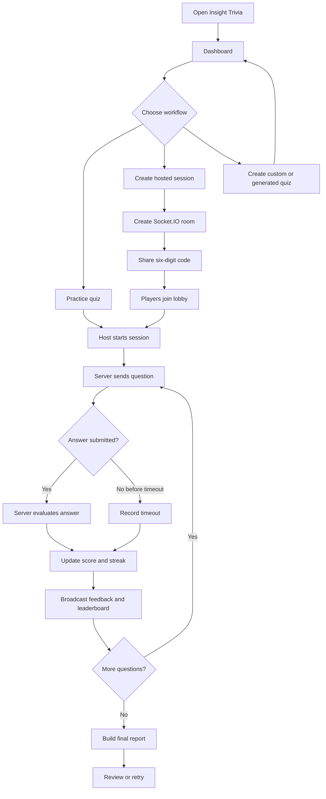

# Insight Trivia
## Real-Time Multiplayer Trivia and Assessment Platform

### Project Report

**Project name:** Insight Trivia  
**Application type:** Web-based real-time quiz and assessment platform  
**Implementation:** HTML, CSS, JavaScript, Node.js, Express, Socket.IO  
**Report date:** September 2026

---

## Table of Contents

| Chapter | Title | Suggested Page |
|---|---|---:|
| 1 | Abstract | 1 |
| 2 | Introduction | 2 |
| 3 | Problem Statement | 3 |
| 4 | System Requirements | 4 |
|  | 4.1 Hardware Requirements | 4 |
|  | 4.2 Software Requirements | 4 |
| 5 | Technologies Used | 5 |
| 6 | Existing System | 7 |
| 7 | Proposed System | 8 |
| 8 | Use Cases | 9 |
| 9 | Process Flow | 10 |
| 10 | Sample Code | 11 |
| 11 | Output Screenshots | 17 |
| 12 | Advantages | 21 |
| 13 | Limitations | 22 |
| 14 | Conclusion | 23 |
| 15 | Future Scope | 24 |
| 16 | References | 25 |

> Page numbers are suggested for a formatted submission. They may change after the Markdown file is converted to Word or PDF.

---

## Chapter 1: Abstract

Insight Trivia is a web-based quiz and assessment platform designed for individual practice and real-time multiplayer sessions. The system allows users to select pre-made quizzes, create custom assessments, generate topic-based quizzes, host sessions, and join sessions using a six-digit room code.

The client interface is implemented with HTML, CSS, and JavaScript. A Node.js and Express server provides static files and REST endpoints for custom quiz storage. Socket.IO supplies real-time communication for lobby management, question delivery, answer submission, timers, score updates, leaderboards, and final results.

The platform includes timed and self-paced modes, speed-based scoring, streak multipliers, three power-ups, simulated participants, profile preferences, audio feedback, and a detailed assessment report. Quiz answers are evaluated on the server so that the correct answer is not sent with the initial question payload.

---

## Chapter 2: Introduction

Online quizzes are widely used for learning, revision, recruitment assessments, classroom activities, and informal competitions.
They help users measure their understanding through questions, answer choices, scores, and performance feedback.
However, many basic quiz applications support only one user and provide limited interaction during the assessment.
They may also depend on an administrator to prepare every question manually before the quiz can be used.

Insight Trivia is developed to provide a complete and flexible digital assessment experience for different types of users.
Players can choose a built-in subject, practice independently, or join a live session hosted by another participant.
Hosts can create a room, share a six-digit code, monitor the lobby, and control the progress of the assessment.
The system therefore combines quiz participation, session management, competition, and learning feedback in one platform.

The application provides a dashboard, custom assessment builder, topic-based quiz generation, real-time lobby, and game screen.
During gameplay, participants receive questions, select answers, use power-ups, view timers, and follow live standings.
The server manages room state, question progression, answer evaluation, scoring, streaks, and participant synchronization.
After the final question, the application displays accuracy, rank, score, maximum streak, and a detailed answer review.

This project demonstrates how HTML, CSS, JavaScript, Node.js, Express, Socket.IO, JSON, and browser storage work together.
It combines REST API requests for quiz persistence with real-time events for multiplayer communication and game updates.
The design also uses Web Audio API feedback, SVG progress graphics, Canvas confetti, and responsive interface components.
As a result, Insight Trivia serves as both a practical assessment tool and an example of full-stack web application development.

---

## Chapter 3: Problem Statement

Traditional quiz workflows often have the following problems:

1. Questions are presented without meaningful competition or live interaction.
2. Users cannot easily create and reuse their own assessment content.
3. Static quiz pages do not synchronize players in real time.
4. Results may be limited to a final score with no question-level review.
5. Timed scoring, streaks, and engagement features are often missing.
6. Hosts have little visibility into participant progress during a session.

The objective of this project is to develop an accessible web platform that supports interactive quiz creation, individual practice, real-time multiplayer play, synchronized scoring, and detailed performance analysis.

---

## Chapter 4: System Requirements

### 4.1 Hardware Requirements

- Computer, tablet, or smartphone with a modern web browser.
- Minimum 2 GB RAM recommended for a smooth browser experience.
- Keyboard and mouse or touchscreen input.
- Network connection for multiplayer sessions and server communication.
- A local machine or hosted server capable of running Node.js.

### 4.2 Software Requirements

- Node.js with npm.
- Modern browser such as Microsoft Edge, Google Chrome, Firefox, or Safari.
- Operating system such as Windows, macOS, or Linux.
- Express 4.x for HTTP server functionality.
- Socket.IO 4.x for real-time event communication.
- JavaScript module support in the browser.
- Optional internet access for Google Fonts and the Puter.js client library.

### Functional Requirements

- Display pre-made quizzes by category.
- Allow a user to save a display name and avatar badge.
- Create and delete custom quizzes.
- Generate topic-based questions through the quiz generator.
- Create or join a session with a six-digit code.
- Display lobby participants and sample questions.
- Support timed and self-paced gameplay.
- Accept answers and calculate score, speed bonus, and streaks.
- Display live standings and host progress statistics.
- Produce a final report with accuracy, score, rank, streak, and question review.

### Non-Functional Requirements

- Responsive and understandable user interface.
- Low-latency updates during a multiplayer session.
- Separation of client presentation and server session state.
- Graceful handling of invalid room codes and disconnected hosts.
- Persistent storage of custom quizzes and local user preferences.

---

## Chapter 5: Technologies Used

| Technology | Purpose |
|---|---|
| HTML5 | Defines dashboard, lobby, game, creator, and report views |
| CSS3 | Provides layout, responsive styling, animations, and theme variables |
| JavaScript ES modules | Implements client-side application behavior |
| Node.js | Runs the application server |
| Express | Serves static files and exposes quiz REST endpoints |
| Socket.IO | Provides real-time rooms and event-based communication |
| JSON | Stores quiz data and transfers structured payloads |
| localStorage | Stores profile settings and locally created quizzes |
| Web Audio API | Generates click, feedback, timer, and completion sounds |
| SVG and Canvas | Renders the accuracy ring and winner confetti |
| Puter.js | Provides the client-side AI generation integration used by the interface |

### Project Files

- `index.html`: application structure and all primary views.
- `styles.css`: visual design system and responsive layout rules.
- `app.js`: client state, event handling, rendering, gameplay, and reports.
- `server.js`: Express API, Socket.IO rooms, scoring, and session lifecycle.
- `quizData.js`: built-in quiz bank and quiz generation logic.
- `audio.js`: Web Audio API sound manager.
- `quizzes.json`: persistent custom quiz data.
- `package.json`: project metadata, scripts, and dependencies.

---

## Chapter 6: Existing System

The existing approach for many basic quiz systems is a static page containing a fixed set of questions. A user selects an answer and receives a score at the end. Such systems usually have no session lobby, no shared room state, no host dashboard, and no real-time leaderboard.

Some systems solve multiplayer requirements by using separate polling requests or a large external platform. These approaches may increase infrastructure requirements and make it difficult to provide a focused custom experience.

The limitations of the typical existing system are limited content management, weak multiplayer synchronization, minimal feedback, and little support for custom learning workflows.

---

## Chapter 7: Proposed System

Insight Trivia proposes a modular client-server quiz platform with the following workflow:

1. The user opens the dashboard and selects a built-in or custom assessment.
2. The host creates a Socket.IO room and receives a six-digit code.
3. Other users enter the code and join the lobby.
4. The host starts a timed or self-paced session.
5. The server broadcasts each question without exposing its answer index.
6. Players submit answers and the server calculates correctness and points.
7. The server broadcasts feedback and updated standings.
8. After the final question, each player receives a detailed report.

The design separates persistent quiz content from temporary room state. The server owns multiplayer state and scoring, while the browser manages presentation, profile preferences, interaction, and local report rendering.

---

## Chapter 8: Use Cases

| Actor | Use Case | Description |
|---|---|---|
| Player | Configure profile | Set a display name and avatar badge. |
| Player | Browse quizzes | View built-in and saved custom assessments. |
| Player | Practice quiz | Start a self-paced individual assessment. |
| Player | Join session | Enter a six-digit room code. |
| Player | Answer question | Select one of four options. |
| Player | Use power-up | Use clarity, double points, or streak shield. |
| Player | View report | Review accuracy, score, rank, streak, and answers. |
| Host | Create session | Select an assessment and create a room. |
| Host | Configure lobby | Set participant limits and simulated candidates. |
| Host | Start session | Launch the quiz for connected participants. |
| Host | Monitor session | View answers received, player count, timer, and standings. |
| Host | Control session | Pause, resume, or advance the question. |
| Creator | Build assessment | Enter a title, category, questions, options, and correct answers. |
| Creator | Generate assessment | Request topic-based questions and launch the result. |

---

## Chapter 9: Process Flow



### Session State Flow

The server manages the states `lobby`, `playing`, `paused`, `feedback`, and `ended`. Questions are started by the server, timers are synchronized through events, and the room advances only after all required answers arrive or the timer expires.

---

## Chapter 10: Sample Code

### Creating a Room

```javascript
socket.on("create-room", ({ quiz, hostName, hostBadge, isPractice }) => {
  const code = Math.floor(100000 + Math.random() * 900000).toString();
  const roomState = {
    code,
    hostSocketId: socket.id,
    quiz,
    players: [{
      socketId: socket.id,
      isHost: true,
      name: hostName || "Host",
      badge: hostBadge || "▲",
      score: 0,
      streak: 0,
      answersLog: []
    }],
    status: "lobby",
    isPractice: !!isPractice
  };

  rooms.set(code, roomState);
  socket.join(code);
  socket.emit("room-created", { code });
});
```

### Server-Side Answer Evaluation

```javascript
const question = room.quiz.questions[room.currentQuestionIndex];
const isCorrect = selectedIndex === question.answerIndex;
let pointsGained = 0;

if (isCorrect) {
  pointsGained = 1000;
  const speedRatio = Math.max(0, 1 - (timeUsedMs / 20000));
  pointsGained += Math.round(1000 * speedRatio);
  pointsGained = Math.round(pointsGained * (1 + player.streak * 0.1));

  if (doubleActive) pointsGained *= 2;
  player.score += pointsGained;
  player.streak++;
} else if (!shieldActive) {
  player.streak = 0;
}
```

### Client Answer Submission

```javascript
function submitMultiplayerAnswer(selectedIndex) {
  document.querySelectorAll("#game-answers-grid .answer-card")
    .forEach(card => card.classList.add("disabled"));

  const timeUsedMs = activeGame.mode === "timed"
    ? Date.now() - activeGame.questionStartTime
    : 0;

  socket.emit("submit-answer", {
    code: activeGame.roomCode,
    selectedIndex,
    timeUsedMs,
    doubleActive: activeGame.powerupActiveThisQuestion.double,
    shieldActive: activeGame.powerupActiveThisQuestion.shield
  });
}
```

### Custom Quiz API

```javascript
app.post("/api/quizzes", (req, res) => {
  const quiz = req.body;
  if (!quiz || !quiz.id || !quiz.questions) {
    return res.status(400).json({ error: "Invalid quiz payload" });
  }

  saveQuiz(quiz);
  res.json({ success: true });
});
```

---

## Chapter 11: Output Screenshots

The final document should include screenshots captured from the running application. Recommended screenshots are:

1. Dashboard showing profile settings, join session, creator tools, and quiz cards.
2. Custom assessment builder with question and answer fields.
3. AI quiz generator panel and generated result.
4. Lobby showing session code, participant list, and syllabus preview.
5. Gameplay screen showing question, answer options, timer, and leaderboard.
6. Host dashboard showing answered count, player count, timer, and controls.
7. Feedback overlay showing correctness, points, and explanation.
8. Final report showing accuracy, rank, score, streak, and detailed review.

Screenshots should be taken with the application running using `npm start`, then inserted below this section in the final Word or PDF version.

---

## Chapter 12: Advantages

- Supports both individual practice and multiplayer competition.
- Uses a simple six-digit room code for joining sessions.
- Provides real-time player updates and leaderboards.
- Keeps answer evaluation on the server during multiplayer play.
- Includes timed scoring, speed bonuses, streaks, and power-ups.
- Allows users to create and reuse custom assessments.
- Provides built-in quiz subjects for immediate use.
- Stores profile preferences and local quiz data in the browser.
- Gives hosts controls for pausing, resuming, and advancing sessions.
- Provides question-level feedback instead of only a final score.
- Uses a lightweight Node.js stack with a small dependency footprint.

---

## Chapter 13: Limitations

- Quiz data is stored in a local JSON file rather than a transactional database.
- The current server is designed for a single running instance and does not include clustered room state.
- Authentication and authorization are not implemented; room access relies on the code.
- The Socket.IO server currently enables permissive cross-origin access.
- Custom quiz payload validation is basic and could be strengthened.
- Browser localStorage is device-specific and is not synchronized to an account.
- The application depends on a network connection for multiplayer play.
- The AI generation workflow depends on the configured client-side integration and may vary by environment.
- The report is rendered locally from received session data and is not exported as a downloadable file.
- Accessibility testing, automated tests, and production monitoring are not included in the current version.

---

## Chapter 14: Conclusion

Insight Trivia successfully demonstrates a complete interactive quiz workflow. It combines assessment creation, local persistence, real-time multiplayer communication, synchronized timers, server-side scoring, player feedback, and performance reporting in a coherent web application.

The project is suitable as an educational prototype and as a foundation for a larger assessment product. Its modular files make it possible to improve storage, identity management, accessibility, analytics, and deployment without replacing the main user workflow.

---

## Chapter 15: Future Scope

1. Add user accounts and secure authentication.
2. Replace JSON storage with PostgreSQL, MongoDB, or another database.
3. Add quiz import and export in JSON, CSV, or spreadsheet formats.
4. Add question explanations, difficulty levels, tags, and categories.
5. Provide downloadable PDF reports and shareable result links.
6. Add an administrator dashboard for moderation and quiz management.
7. Add persistent global rankings and historical performance analytics.
8. Improve mobile accessibility and keyboard navigation.
9. Add automated unit, integration, and end-to-end tests.
10. Use a message adapter or shared store for horizontally scaled Socket.IO servers.
11. Add rate limiting, schema validation, authentication, and secure CORS configuration.
12. Support multilingual quizzes and configurable time limits.

---

## Chapter 16: References

1. Node.js Documentation: https://nodejs.org/docs/latest/api/
2. Express.js Documentation: https://expressjs.com/
3. Socket.IO Documentation: https://socket.io/docs/v4/
4. MDN Web Docs, Web Storage API: https://developer.mozilla.org/docs/Web/API/Web_Storage_API
5. MDN Web Docs, Web Audio API: https://developer.mozilla.org/docs/Web/API/Web_Audio_API
6. MDN Web Docs, Canvas API: https://developer.mozilla.org/docs/Web/API/Canvas_API
7. Project source files: `index.html`, `styles.css`, `app.js`, `server.js`, `quizData.js`, and `audio.js`.
